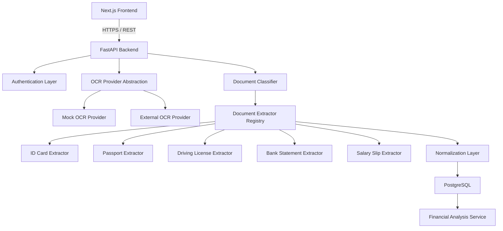

# OCR Document Extraction Platform

A production-structured OCR document extraction platform built with **FastAPI**, **PostgreSQL**, **SQLAlchemy 2.x**, **Alembic**, **Next.js**, **TypeScript**, and **Tailwind CSS**.

The platform lets authenticated users upload sensitive documents such as identity cards, passports, driving licenses, bank statements, and salary slips. Uploaded files are validated, sent to an OCR provider through an abstraction layer, structured into normalized fields, stored in PostgreSQL, and made available only to the owning user.

> **MVP storage rule:** the original uploaded document is processed temporarily and is **not** permanently stored.
>
> **Default OCR mode:** the current default runtime uses **local OCR inside the backend container/application** and does not send uploaded files to any external AI service unless you explicitly switch `OCR_PROVIDER=external`.

---

## Features

- User registration, login, logout, and authenticated profile retrieval
- JWT-based authentication with Argon2 password hashing
- Per-user document authorization checks
- Secure file validation for PDF, JPG/JPEG, and PNG
- OCR provider abstraction with:
  - `MockOCRProvider` for local development and tests
  - `ExternalOCRProvider` for future real OCR integration
- Rule-based document classification
- Structured extraction for:
  - ID cards
  - Passports
  - Driving licenses
  - Bank statements
  - Salary slips
- PostgreSQL-backed storage for document metadata and JSON extraction payloads
- Financial summary foundation for bank statement transactions
- Alembic migrations
- Docker Compose for local development
- Automated backend tests for auth, authz, uploads, OCR, extraction, and finance

---

## Architecture



### Processing flow

```text
User Login
  ↓
Authenticated Upload
  ↓
File Validation
  ↓
OCR Provider
  ↓
OCR Result
  ↓
Document Classification
  ↓
Structured Extraction
  ↓
Normalization / Validation
  ↓
PostgreSQL Storage
  ↓
User Retrieval
```

---

## Project Structure

```text
AI-OCR/
├── backend/
│   ├── app/
│   │   ├── api/
│   │   ├── core/
│   │   ├── db/
│   │   ├── schemas/
│   │   ├── services/
│   │   └── utils/
│   ├── alembic/
│   ├── tests/
│   ├── .env.example
│   ├── Dockerfile
│   ├── requirements.txt
│   └── alembic.ini
├── frontend/
│   ├── app/
│   ├── components/
│   ├── lib/
│   ├── types/
│   ├── .env.example
│   ├── Dockerfile
│   └── package.json
├── ocr-service/
│   ├── app/
│   ├── Dockerfile
│   └── requirements.txt
├── docker-compose.yml
├── .gitignore
└── README.md
```

---

## Tech Stack

### Backend

- Python 3.12+
- FastAPI
- SQLAlchemy 2.x
- PostgreSQL
- Alembic
- Pydantic v2
- `python-jose`
- `passlib[argon2]`
- `httpx`
- `pytest`
- `pytest-asyncio`

### Frontend

- Next.js
- React
- TypeScript
- Tailwind CSS

---

## Requirements

You can run the project either with Docker or locally.

### Docker

- Docker
- Docker Compose

### Local

- Python 3.12+
- Node.js 20+
- npm
- PostgreSQL 15+

---

## Environment Variables

### Backend: `backend/.env`

Start from `backend/.env.example`.

| Variable | Description |
|---|---|
| `APP_NAME` | FastAPI application name |
| `ENVIRONMENT` | `development`, `test`, or `production` |
| `API_V1_PREFIX` | API prefix, default `/api/v1` |
| `DATABASE_URL` | SQLAlchemy async database URL |
| `JWT_SECRET_KEY` | Secret used to sign access tokens |
| `JWT_ALGORITHM` | JWT signing algorithm |
| `ACCESS_TOKEN_EXPIRE_MINUTES` | Access token expiration time |
| `OCR_PROVIDER` | `mock` or `external` |
| `OCR_API_URL` | External OCR endpoint |
| `OCR_API_KEY` | External OCR API key |
| `MAX_UPLOAD_SIZE_MB` | Max upload size |
| `ALLOWED_ORIGINS` | CORS allowed origins |
| `STORE_RAW_OCR_TEXT` | Whether to persist raw OCR text |
| `EXTRACTION_VERSION` | Stored extraction version |
| `HTTP_TIMEOUT_SECONDS` | Timeout for external OCR calls |

### Frontend: `frontend/.env.local`

Start from `frontend/.env.example`.

| Variable | Description |
|---|---|
| `NEXT_PUBLIC_API_BASE_URL` | Browser-visible base URL for the FastAPI API |

---

## Quick Start with Docker

1. Copy env files if you want to customize them.
2. Start the stack.

```bash
cd /Users/inintr00350/Desktop/AI-OCR
docker compose up --build
```

Services:

- Frontend: `http://localhost:3000`
- Backend: `http://localhost:8000`
- Swagger docs: `http://localhost:8000/docs`
- ReDoc: `http://localhost:8000/redoc`
- PostgreSQL: `localhost:5432`

---

## Local Development Setup

### 1) Backend

```bash
cd /Users/inintr00350/Desktop/AI-OCR/backend
cp .env.example .env
python3 -m venv .venv
source .venv/bin/activate
pip install -r requirements.txt
alembic upgrade head
uvicorn app.main:app --reload --host 0.0.0.0 --port 8000
```

If you run the backend outside Docker and want local OCR, install Tesseract on your machine as well.

Example on macOS with Homebrew:

```bash
brew install tesseract
```

### 2) Frontend

```bash
cd /Users/inintr00350/Desktop/AI-OCR/frontend
cp .env.example .env.local
npm install
npm run dev
```

---

## Database and Migrations

The initial schema includes:

- `users`
- `documents`
- `document_extractions`

### Run migrations

```bash
cd /Users/inintr00350/Desktop/AI-OCR/backend
source .venv/bin/activate
alembic upgrade head
```

### Create a new migration later

```bash
cd /Users/inintr00350/Desktop/AI-OCR/backend
source .venv/bin/activate
alembic revision --autogenerate -m "describe change"
```

---

## OCR Provider Configuration

### Mock OCR provider

Use this for local development and tests:

```env
OCR_PROVIDER=mock
```

The mock provider returns sample OCR data based on the filename:

- `id-card.pdf`
- `passport.jpg`
- `license.pdf`
- `bank.pdf`
- `salary.png`

### External OCR provider

```env
OCR_PROVIDER=external
OCR_API_URL=http://ocr-service:8080/extract
OCR_API_KEY=internal-ocr-secret
```

The external provider converts arbitrary provider responses into the internal normalized `OCRResult` structure.

This mode is optional. Use it only if you explicitly want the backend to call a separate OCR microservice over HTTP.

### Self-hosted PaddleOCR microservice

The repository includes a dedicated OCR microservice at `ocr-service/` that can be enabled when needed.

Characteristics:

- open-source PaddleOCR
- self-hosted inside Docker Compose
- private network call from backend to OCR service
- no public third-party OCR vendor required
- suitable when confidentiality matters more than using a public SaaS OCR API

The OCR service exposes:

- `GET /health`
- `POST /extract`

The backend already knows how to call it through `ExternalOCRProvider`.

### Local OCR provider

This is the default application mode:

```env
OCR_PROVIDER=local
```

In this mode:

- images are OCR-processed locally with Tesseract
- PDFs first attempt embedded text extraction locally
- scanned PDFs fall back to local page rendering + Tesseract OCR
- uploaded files are not sent to any external AI service

---

## API Overview

Base path: `/api/v1`

### Auth

- `POST /api/v1/auth/register`
- `POST /api/v1/auth/login`
- `GET /api/v1/auth/me`
- `POST /api/v1/auth/logout`

There are **no pre-seeded login credentials** in this project. Register a user first from the UI or API, then log in with that account.

### Documents

- `POST /api/v1/documents`
- `GET /api/v1/documents`
- `GET /api/v1/documents/dashboard`
- `GET /api/v1/documents/{document_id}`
- `GET /api/v1/documents/{document_id}/extraction`
- `DELETE /api/v1/documents/{document_id}`

### Financial

- `GET /api/v1/financial/summary`
- `GET /api/v1/financial/transactions`
- `GET /api/v1/financial/monthly-summary`

### Example upload response

```json
{
  "document_id": "uuid",
  "document_type": "ID_CARD",
  "status": "COMPLETED",
  "extraction": {
    "name": "John Doe",
    "date_of_birth": "1995-04-12",
    "gender": "Male",
    "document_number": "ABCD1234"
  },
  "confidence": 0.96,
  "extraction_version": "v1"
}
```

---

## Security Notes

This platform handles highly sensitive personal and financial data.

Implemented safeguards include:

- Argon2 password hashing
- JWT authentication
- Per-user document ownership checks
- No permanent storage of uploaded originals
- MIME type + file extension + file signature validation
- Upload size limits
- Sensitive field masking in the frontend
- No OCR API keys or DB credentials exposed to the frontend
- No raw OCR output exposed in user-facing APIs
- Structured API error responses
- Environment-based configuration

Recommended production safeguards:

- HTTPS only
- Managed secret storage
- Encrypted database/storage at rest
- WAF / rate limiting / abuse protection
- Secure cookie/session strategy if moving away from bearer tokens
- Audit logging with masked identifiers only

---

## Testing

Backend tests are included for:

- registration and login
- duplicate-email protection
- unauthorized access
- document ownership authorization
- upload validation
- OCR mocking and malformed responses
- extraction for all supported document types
- financial summary calculations

### Run backend tests

```bash
cd /Users/inintr00350/Desktop/AI-OCR/backend
source .venv/bin/activate
pytest -q
```

---

## Verified Status

The backend test suite was run in this workspace and passed:

- `25 passed`

This verifies the current backend implementation for:

- auth flow
- upload flow
- extraction flow
- authorization checks
- financial endpoints

The frontend dependency tree and production build were also verified in this workspace:

- `npm audit` reported `0 vulnerabilities`
- `npm run build` succeeded on Next.js `16.4.0`

---

## Frontend Pages

Implemented pages:

- `/login`
- `/register`
- `/dashboard`
- `/documents`
- `/documents/[id]`
- `/upload`
- `/profile`

The frontend uses a simple cookie-based bearer-token persistence approach for the MVP and route protection via Next.js `proxy.ts`.

---

## Extension Points

This MVP was intentionally structured so future features can be added without major rewrites.

### Future OCR providers

Add another implementation under `backend/app/services/ocr/` and wire it through `OCRProviderFactory`.

### Future document storage

Current behavior: temporary processing only.

Future: add S3 / GCS / Blob storage metadata without changing extraction logic.

### Future async processing

Current behavior: synchronous request/response OCR processing.

Future: replace the upload orchestration with queue + worker processing while preserving the same service boundaries.

### Future ML classification

Replace the rule-based `DocumentClassifier` with a model-backed classifier while keeping the downstream extraction contract unchanged.

### Future financial analytics

The current JSON transaction extraction already feeds `FinancialAnalysisService`. A dedicated `bank_transactions` table can be added later without redesigning the OCR or extraction layers.

---

## Important Implementation Notes

- Uploaded originals are **not** stored permanently.
- Raw OCR text is optionally stored for reprocessing and should be treated as highly sensitive.
- The mock OCR provider keeps the app runnable without paid OCR dependencies.
- JSON extraction payloads are stored in a schema-flexible way while preserving relational ownership and document metadata.

---

## Known MVP Tradeoffs

- The frontend currently stores the bearer token in a browser cookie for session persistence; for a hardened production deployment, consider a more robust HTTP-only session strategy.
- The mock OCR provider uses filename-based sample payload selection for developer convenience.
- Financial transactions are stored inside extraction JSON in the MVP, ready for later normalization.
- Next.js `16.4.0` builds cleanly here, but it warns that React 18 support is deprecated upstream, so a React 19 upgrade should be planned for a future iteration.

---

## License / Usage

This repository is intended as a secure starter platform for OCR document extraction workflows.

